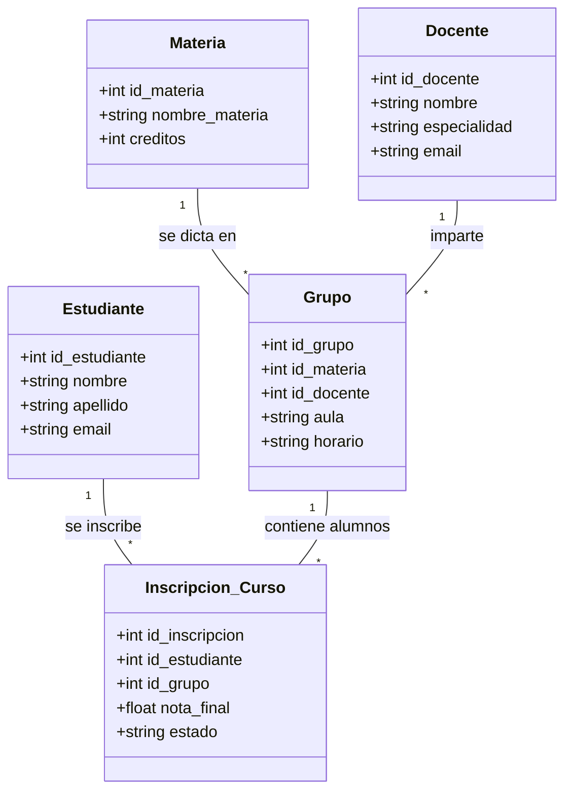

# PRÁCTICA ACADÉMICA - SISTEMA DE GESTIÓN UNIAJC (MVC + DB)

## Objetivo
Replicar el ecosistema académico propuesto en el diagrama Mermaid, siguiendo los estándares de arquitectura en capas (Entidad, DAO, Service, Controller, Vista).

## Diagrama del Ecosistema

## Instrucciones para el Estudiante:
1.  **Crea tu propia rama:** `feature/practica-[TuNombre]`.
2.  **Entidad:** Crea las clases en el paquete `com.uniajc.modelo` para las entidades del ecosistema.
3.  **DAO:** Implementa la persistencia en `com.uniajc.dao` usando JDBC y `ConexionDatabase`.
4.  **Servicio:** Agrega la lógica de negocio (validaciones de integridad).
5.  **Vistas:** Implementa interfaces tanto para Scanner como para Swing.
6.  **Pruebas:** Asegúrate de que tu código pase los tests de validación del docente.

## Configuración de BD:
El proyecto utiliza PostgreSQL (incluido Neon). Configura las propiedades `URL`, `USERNAME` y `PASSWORD` en tu archivo `config.properties` de la raíz del proyecto. Ese archivo está ignorado por Git para no publicar credenciales. Para crear las tablas, conecta DBeaver a Neon y ejecuta una vez `src/main/resources/db/schema-postgres.sql`.

## Ejecutar la aplicación

- Consola con `Scanner` (PowerShell): `mvn exec:java '-Dexec.mainClass=com.uniajc.Main'`
- Interfaz Swing (PowerShell): `mvn exec:java '-Dexec.mainClass=com.uniajc.Main' '-Dexec.args=--swing'`
- Desde VS Code: abre la carpeta del proyecto, selecciona **Sistema académico (Swing)** en **Run and Debug** y ejecútalo con `F5`.

---
*Recuerda: El Modelo nunca debe hablar con el usuario (sin System.out). El Controlador orquesta y la Vista interactúa.*

Creado para una prueba.